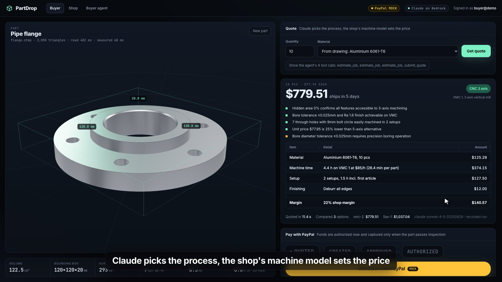

# PartDrop

Drop a CAD file, get a machine-time quote in seconds, pay with PayPal. The money is only authorized at checkout. It is captured, and the machine shop is paid out, when the finished part passes an inspection where Claude vision and a deterministic tolerance check both agree. A buyer's own purchasing agent can do the whole order from one sentence, inside a spending mandate the server enforces.



**PayPal mode used in the film: MOCK.** No PayPal sandbox credentials were available while this was built, so the film runs against `PAYPAL_MODE=mock`, a local fake of the exact PayPal REST endpoints. The same client code talks to the real sandbox when `PAYPAL_MODE=sandbox` and credentials are set; that path is written but was not run against PayPal yet. See Limitations.

## What it does

1. **Buyer** drops a STEP or STL file. OpenCascade (WASM) tessellates it in a Web Worker and the browser measures volume, bounding box, surface area, holes (concave cylinder faces from the B-rep, plus Euler genus), wall thickness (inward ray casts), how much surface a straight tool cannot reach from 6 or 26 directions, and whether the part is a constant thickness sheet with bends.
2. **Quote agent**: Claude Sonnet 4.5 on Amazon Bedrock (Converse API with tools) reads those features, the drawing notes and a render of the part, calls `estimate_job` in parallel on 2 or 3 of the shop's machines, then `submit_quote`. Every number comes from a deterministic machine time model (`server/src/shop.ts`): stock, removal rate, finishing, drilling, setups, LPBF layers and nesting, laser cut length and bends, rates, margin, and the lead time from the live machine schedule. Claude chooses and explains, it never writes a price.
3. **PayPal checkout**: Orders v2 with `intent: AUTHORIZE`. The buyer approves, the server authorizes, the funds are held. The job is booked on the machine's schedule.
4. **Shop** sees the job on a **Bryntum Gantt** machine schedule, watches a stylised factory view machine (or print) the actual part geometry, and enters measured sizes in an **AG Grid**.
5. **Inspection agent**: Claude vision compares the inspection photo with a render of the CAD model and counts the holes it sees; code checks every measured size against its tolerance. Both pass: capture the authorization, then a PayPal **Payout** to the shop (minus a 5% platform fee). Both fail: void the authorization. They disagree: hold for a human. The model's own hole count is also checked in code.
6. **Webhooks**: every PayPal event (CHECKOUT.ORDER.APPROVED, PAYMENT.AUTHORIZATION.CREATED, PAYMENT.CAPTURE.COMPLETED, PAYMENT.AUTHORIZATION.VOIDED, PAYMENT.PAYOUTSBATCH.SUCCESS) is signature verified (SHA256withRSA over `transmissionId|time|webhookId|crc32(body)` with the cert from `paypal-cert-url`, or the postback API) before it touches an order.
7. **Ledger**: every money movement (AUTHORIZE, CAPTURE, PAYOUT, VOID, HOLD) is stored with the evidence that triggered it: inspection id, photo SHA-256, worst feature and how much of its tolerance it used, AI verdict and reasons, PayPal fee, the verified webhook id.
8. **Buyer agent** (agentic commerce): Claude with tools `find_part`, `get_quote` (runs the quote agent), `create_order` and `get_order` (named after the PayPal Agent Toolkit payment tools) orders "50 angle brackets in 6061, budget $2,500, within two weeks". It pays from a vaulted PayPal wallet with intent AUTHORIZE. The server enforces the mandate (per order limit, one order per run, no capture rights).

## Run it

```bash
npm i                       # also copies the OpenCascade WASM into web/public/occt
cp .env.example .env        # add AWS_BEARER_TOKEN_BEDROCK
npm run dev                 # API on :8306, web on :5306
open http://localhost:5306
```

Test logins: **buyer@demo** and **shop@demo**, password **partdrop**. Try the sample parts on the drop zone (angle bracket, pipe flange, injector face, sheet metal cover), or drop your own STEP or STL.

Production style: `npm run build && npm start` serves the built web app from the API on :8306.

### Tests

```bash
npm test                    # 21 unit tests: estimator, geometry of the samples, tolerance check, PayPal mock lifecycle, webhook signature verification
npx tsx scripts/smoke.ts    # end to end against a running API: quote, PayPal order, approve, authorize, inspect, capture, payout, webhooks
PHOTO=samples/photos/flange_defect.jpg npx tsx scripts/smoke.ts          # defective part, expect HOLD
PHOTO=samples/photos/flange_defect.jpg BAD=1 npx tsx scripts/smoke.ts    # defect plus out of tolerance, expect VOID
npm run typecheck
```

Inspection results I measured with live Claude calls (small sample, not a benchmark): good flange photo 3 of 3 PASS and captured; flange with one bolt hole missing and a gouge 3 of 3 not paid (HOLD); defect plus out of tolerance size 1 of 1 VOID.

### Switch to the real PayPal sandbox

1. developer.paypal.com: create a sandbox app, copy client id and secret, create a webhook for the events above pointing at `https://<api>/api/paypal/webhook`, copy its id.
2. Put `PAYPAL_MODE=sandbox`, `PAYPAL_CLIENT_ID`, `PAYPAL_CLIENT_SECRET`, `PAYPAL_WEBHOOK_ID` in `.env`. The checkout then renders the real PayPal JS SDK buttons (`intent=authorize`).
3. Payouts must be enabled on the sandbox business account. For the buyer agent to pay without a redirect, save a vaulted PayPal wallet and set `PAYPAL_VAULT_ID`; without it the agent returns the approval link for the human.

## Architecture

```
 Browser (React + Vite)                         API (Node, Express, TypeScript)
 ┌──────────────────────────────┐              ┌──────────────────────────────────────────┐
 │ Buyer  drop STEP/STL         │              │ /api/quotes  quote agent ──► Bedrock      │
 │  Worker: OpenCascade WASM ──►│ features +   │   tools: estimate_job ─► shop.ts model    │
 │  geometry.ts (BVH rays)      │ render PNG ─►│          submit_quote                     │
 │ Three.js viewer              │              │ /api/orders  PayPal Orders v2 AUTHORIZE ─┐│
 │ PayPal JS SDK / mock popup ──┼─ approve ───►│ /approved    authorize, book job         ││
 │ Shop  Bryntum Gantt          │◄── SSE ──────│ /inspect     Claude vision + tolerance   ││
 │       Three.js factory view  │              │   CAPTURE + Payout | VOID | HOLD         ││
 │       AG Grid measurements   │              │ /paypal/webhook  verify signature ◄──────┤│
 │       AG Grid money ledger   │              │ /agent/run   buyer agent ─► Bedrock      ││
 │ Agent one sentence order     │              │   find_part get_quote create_order ...   ││
 └──────────────────────────────┘              │ ledger + orders + jobs (JSON store)      ││
                                               └──────────────┬───────────────────────────┘│
                                    PAYPAL_MODE=sandbox ──────┤ api-m.sandbox.paypal.com   │
                                    PAYPAL_MODE=mock    ──────┘ /mock-paypal (same paths) ◄┘
```

Key files: `shared/geometry.ts` (features), `server/src/shop.ts` (machines and estimator), `server/src/quote.ts`, `server/src/inspect.ts`, `server/src/agent.ts`, `server/src/orders.ts` (money flow and ledger), `server/src/paypal/client.ts` (REST client and webhook verification), `server/src/paypal/mock.ts` (the fake), `web/src/shop/Schedule.tsx` (Bryntum), `web/src/film/` (film director and virtual clock).

## Film

`output/partdrop-screen.mp4`, 1920x1080, 30 fps, 2:37, stills in `output/stills/`. It is the real app driven by a scripted director (`web/src/film/Director.tsx`) on a virtual clock, captured frame by frame by Playwright (`output/record.mjs`). The cursor, the dragged file chip, the inbox scene and the captions are film overlays. The machining view runs at a stated speed up (about 1,180x).

AI in the film is **replayed**: a rehearsal run (`AI_MODE=record`) called Claude on Bedrock for real and saved every response in `server/cassettes/`; the filmed run (`AI_MODE=replay`) serves those responses. "Quoted in 11.4 s" is the latency of the recorded live call.

```bash
npx vite --config web/vite.config.ts &
DETERMINISTIC_IDS=1 AI_MODE=record npx tsx server/src/index.ts &   # rehearsal
node output/record.mjs --dry
# restart the API with AI_MODE=replay, then
node output/record.mjs
```

## Built in the hackathon window vs pre-existing

Everything in this repo was written for this entry. Ideas reused from my earlier work: the STEP viewing approach (Three.js plus occt-import-js) and the frame stepped Playwright recorder pattern. The sample parts are new build123d models (`samples/make_parts.py`).

## Limitations

- **PayPal ran in mock mode.** `server/src/paypal/mock.ts` imitates the documented request bodies, response shapes, statuses (CREATED, APPROVED, COMPLETED, authorization CREATED/CAPTURED/VOIDED, capture COMPLETED, payout PENDING then SUCCESS), error names (ORDER_NOT_APPROVED, AUTHORIZATION_ALREADY_CAPTURED, AUTHORIZATION_VOIDED, PREVIOUSLY_CAPTURED), idempotency by PayPal-Request-Id and signed webhooks. The mock's fee (3.49% + $0.49) and ids are invented. The sandbox path has not been exercised against PayPal yet.
- The mock approval page is a stand in for the PayPal popup and says so on screen.
- Authorizations are honored for 3 days and expire after 29; jobs longer than that would need a reauthorization, which is not implemented (an expired authorization goes to HOLD).
- Payout to the shop assumes the platform holds the captured funds (Payouts from the platform balance). A production build should use PayPal multiparty (platform fees, payee) instead.
- The machine time model is a transparent first order model with documented constants, not CAM. Tool reach is a straight line of sight test, it ignores tool diameter and holder collisions. Setups are estimated.
- Inspection photos are 3D renders of the sample parts on a stand in granite plate (`scripts/render-photos.mjs`), not camera photos. The vision check was tested on a handful of runs only (numbers above). Claude initially missed a missing hole until it was given a CAD reference image and asked to count; it is a second opinion next to the measured sizes, never the only gate.
- The factory view is stylised and accelerated; it shows the real part geometry being revealed, not a toolpath simulation.
- Data lives in a JSON file (`data/state.json`); on Render's free plan it resets on deploy. Auth is two fixed demo accounts with HMAC tokens.
- Bryntum Gantt is the public npm **trial** package (`@bryntum/gantt-trial`), which shows a trial watermark. A license is needed for production.
- Not deployed. `render.yaml` is ready but untested on Render.
- The inbox at the start of the film is an illustration, not a real supplier.

## Attribution

Three.js (MIT), three-mesh-bvh (MIT), occt-import-js and OpenCascade (LGPL 2.1, loaded as a separate WASM file), React (MIT), Vite (MIT), Express (MIT), AG Grid Community (MIT), Bryntum Gantt trial (commercial trial licence), build123d (Apache 2.0) for the sample parts, Inter and JetBrains Mono fonts (OFL). Claude Sonnet 4.5 via Amazon Bedrock. PayPal is a trademark of PayPal, Inc.; this project is not affiliated with PayPal.

## License

MIT, see `LICENSE`.
